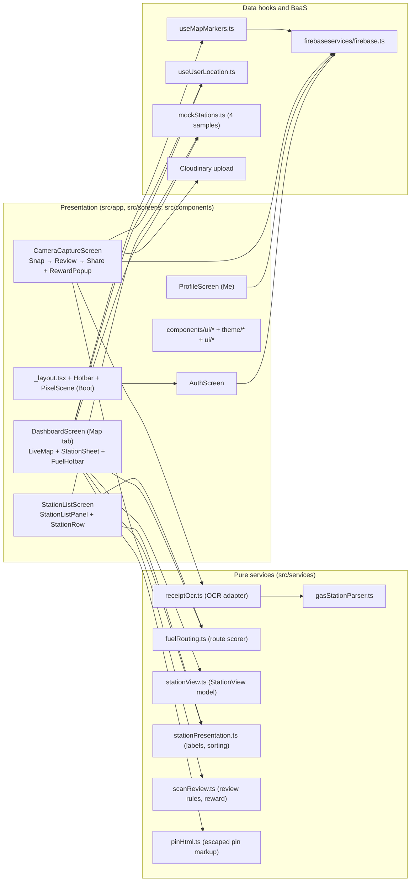

# Architecture: GasUp365

Created: 2026-10-21T10:55:54+08:00
Updated: 2026-10-22T20:01:25+08:00
Revision: 2
Status: Draft

Revision 2 describes the code on `feat/ui-redesign` (`94497ea`), after the "Pixel Pump Town" UI redesign. Revision 1 described `main` at `c0207da`.

## Observed facts and assumptions

### Verified Facts (from [../RECON_REPORT.md](../RECON_REPORT.md), sections 1–7)
- **Runtime & Framework**: Expo SDK 55 (`~55.0.24`), React Native `0.83.6`, React `19.2.0`, TypeScript `5.9.2` (`strict: true`), Expo Router (`~55.0.14`) with `typedRoutes` and `reactCompiler` enabled.
- **Entry Point**: `package.json` boots `expo-router/entry` → `src/app/_layout.tsx`. The root layout loads the fonts (`useFonts`), shows the Boot scene while auth resolves, gates the tabs behind Firebase Auth `onAuthStateChanged`, and renders the custom `Hotbar` tab bar (a left rail at ≥ 1024 px). Legacy `index.js` and `src/App.tsx` are unused leftovers.
- **Routes**: `index` (Map), `list` (Stations), `add` (Scan), `profile` (Me), and the hidden `map` route (`href: null`, legacy).
- **Backend-as-a-Service (BaaS)**:
  - **Firebase Auth**: Email/Password login and registration (`src/firebaseservices/firebase.ts`, `src/screens/AuthScreen.tsx`). `src/services/firebase.ts` only re-exports the same module.
  - **Cloud Firestore**: `markers` (written by Scan, read by `useMapMarkers`) and `users` (written once at sign-up, never read).
  - **Cloudinary**: Direct client-side unsigned image upload (`https://api.cloudinary.com/v1_1/dzisx3ntp/image/upload`, preset `pictures`) in `src/screens/CameraCaptureScreen.tsx`.
- **Map Engine**: `src/components/LiveMap.tsx` runs one Leaflet controller in a `react-native-webview` on iOS/Android (Leaflet loaded from unpkg) and with DOM `leaflet` on Web. Pins are `divIcon` pixel-art markup built by `src/services/pinHtml.ts`; there are no popups. The legacy `src/screens/StationLeafletMap.tsx` (`expo-leaflet-navigation-map`) is used only by the hidden `/map` route.
- **OCR + NLP Pipeline**:
  - `src/services/receiptOcr.ts` dynamically imports `expo-text-recognition` on native mobile and throws a clear unsupported error on Web.
  - `src/services/gasStationParser.ts` extracts Philippine fuel brands, addresses, EXIF GPS coordinates, and fuel prices (`unleaded`, `special`, `diesel`).
- **UI system**: tokens in `src/theme/` (`colors.ts`, `tokens.ts` for fonts, type scale, shadows, spacing and the 1024 px breakpoint, `pixel.ts` for shared styles and fuel metadata), pixel icons and sprites in `src/ui/` drawn with `react-native-svg`, and shared controls in `src/components/ui/`. Fonts: Pixelify Sans (titles, buttons, station names), Silkscreen (tags), Nunito (body text and all prices).

### Assumptions
- Firebase project `gasup365` security rules permit authenticated client reads/writes to `markers` and `users/{uid}` (`useMapMarkers.ts` treats `permission-denied` as zero community markers and logs a warning; the 4 sample stations always show).
- Cloudinary unsigned preset `pictures` on cloud `dzisx3ntp` remains active for hackathon/MVP uploads unless overridden via `EXPO_PUBLIC_CLOUDINARY_*` env vars.

## Components, boundaries, and flows

### Architectural Boundaries & Rules
1. **Pure Domain Services (`src/services/`)**:
   - `gasStationParser.ts`, `fuelRouting.ts`, `stationView.ts`, `stationPresentation.ts`, `scanReview.ts` and `pinHtml.ts` must stay pure, deterministic TypeScript with no React Native or Firebase runtime imports, so Jest (`ts-jest`) can test them in Node. (`stationView.ts` imports only the `MapMarker` type; `pinHtml.ts` imports only the pixel-art data in `src/ui/pixelArt.ts`.)
2. **Platform-Safe Adapters**:
   - Native-only modules (`expo-text-recognition`, `expo-camera`, `react-native-webview`) must be isolated behind platform checks (`Platform.OS === 'web'`) or dynamic imports so Web builds never crash.
3. **One station shape for the UI**:
   - Screens render stations through `StationView` (`stationView.ts`): `fromScore` for scored sample stations, `fromMarker` for community markers. Today only sample stations are scored and listed; FEAT-001 should make community markers flow through `scoreStationsForRoute` and the Stations list as well.
4. **No raw data in HTML**:
   - Any Firestore value placed in map markup must go through `escapeHtml` (`pinHtml.ts`).
5. **Rules follow the writers**:
   - `firestore.rules` accepts exactly the fields `CameraCaptureScreen` and `AuthScreen` write. Any change to a Firestore write needs a matching rules change and a `firestore/rules.test.ts` case.
6. **No `Alert.alert`**:
   - `react-native-web` implements it as a no-op, so user-facing messages use `Dialog` and `Toast` from `src/components/ui/Dialog.tsx`.

## Decisions and trade-offs

| Decision Area | Chosen Approach | Alternatives Considered | Rationale |
| :--- | :--- | :--- | :--- |
| **Development Workflow** | **5-Stage Document-Driven TDD**: `1. Spec` → `2. Design` → `3. Create Test` → `4. Generate Code` → `5. Optimize/Bugfix` | Ad-hoc coding without specs or tests | Prevents frontend/backend disconnects (like the original `markers` price drop) and guarantees every requirement has an observable test. |
| **Map Component Standard** | `src/components/LiveMap.tsx` (`WebView` + DOM `leaflet`) with `divIcon` pins | `expo-leaflet-navigation-map` (`StationLeafletMap.tsx`) | Handles Web and Mobile with one controller, user GPS location and custom pins. Done in the redesign; the alternative now lives only in the hidden route. |
| **Layout** | "World + HUD": full-screen map with a floating HUD and a tap-to-expand station sheet; two panes at ≥ 1024 px (DESIGN-002 §4) | Tabbed list-first layout | Chosen after the 2026-10-22 council review; suits the exhibit demo. |
| **Icons** | Custom pixel icons and sprites in `src/ui/`, drawn with `react-native-svg` | Feather (`@expo/vector-icons`) | Matches the pixel art direction. `@expo/vector-icons` remains only for legacy files. |
| **Theme** | Light ("Day") only, `app.json` `userInterfaceStyle: "light"` | Day and Night themes | DESIGN-002 §13 Q7 proposed default; awaiting Len's confirmation. |
| **Backend Architecture** | Serverless Client-Direct BaaS (Firebase Auth + Firestore + Cloudinary) | Custom Node/Express backend | Zero server maintenance for the Kalibo MVP; real-time `onSnapshot` updates work out of the box. |

## Open questions and approval

- **Question 1 (resolved by the redesign, needs confirmation)**: Revision 1 asked whether to remove the hidden `/map` route once its features moved into `DashboardScreen`. They have moved. **Proposed**: delete `src/app/map.tsx`, `MapViewScreen.tsx`, `StationLeafletMap.tsx`, `StationMap.tsx`, `StationMap.native.tsx` and `StationCard.tsx` in FEAT-004.
- **Question 2 (answered 2026-10-22)**: Add `firestore.rules` to the repo? Len: "yes add firestore security rules". Done; see [../evidence/FIRESTORE-RULES-verification.md](../evidence/FIRESTORE-RULES-verification.md). Not deployed yet.
- **Len's Approval**: *Pending chat review and approval of Revision 2.*
