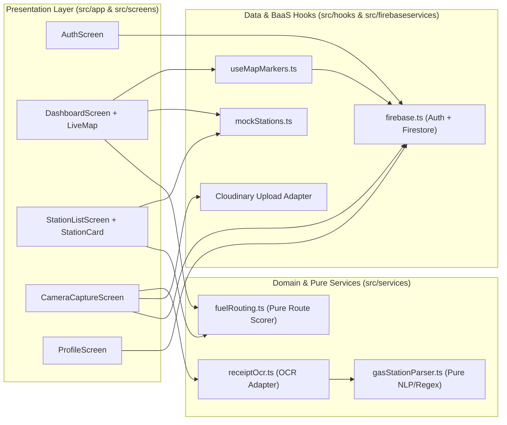

# Architecture: GasUp365

Created: 2026-10-21T10:55:54+08:00
Updated: 2026-10-21T10:55:54+08:00
Revision: 1
Status: Draft

## Observed facts and assumptions

### Verified Facts (from [../RECON_REPORT.md](../RECON_REPORT.md))
- **Runtime & Framework**: Expo SDK 55 (`~55.0.24`), React Native `0.83.6`, React `19.2.0`, TypeScript `5.9.2` (`strict: true`), Expo Router (`~55.0.14`) with `typedRoutes` and `reactCompiler` enabled.
- **Entry Point**: `package.json` boots `expo-router/entry` → `src/app/_layout.tsx` (which gates tabs behind Firebase Auth `onAuthStateChanged`). Legacy `index.js` and `src/App.tsx` are unused leftovers.
- **Backend-as-a-Service (BaaS)**:
  - **Firebase Auth**: Email/Password login and registration (`src/firebaseservices/firebase.ts`, `src/screens/AuthScreen.tsx`).
  - **Cloud Firestore**: Real-time NoSQL store using `markers` and `users` collections.
  - **Cloudinary**: Direct client-side unsigned image upload (`https://api.cloudinary.com/v1_1/dzisx3ntp/image/upload`, preset `pictures`) in `src/screens/CameraCaptureScreen.tsx`.
- **Map Engines**:
  - `src/components/LiveMap.tsx` renders Leaflet via `react-native-webview` on iOS/Android and native DOM `leaflet` on Web.
  - `src/screens/StationLeafletMap.tsx` uses `expo-leaflet-navigation-map` on the hidden `/map` route (`src/screens/MapViewScreen.tsx`).
- **OCR + NLP Pipeline**:
  - `src/services/receiptOcr.ts` dynamically imports `expo-text-recognition` on native mobile and throws a clear unsupported error on Web.
  - `src/services/gasStationParser.ts` extracts Philippine fuel brands, addresses, EXIF GPS coordinates, and fuel prices (`unleaded`, `special`, `diesel`).

### Assumptions
- Firebase project `gasup365` security rules permit authenticated client reads/writes to `markers` and `users/{uid}` (note: `useMapMarkers.ts` includes a fallback handler for `permission-denied`).
- Cloudinary unsigned preset `pictures` on cloud `dzisx3ntp` remains active for hackathon/MVP uploads unless overridden via `EXPO_PUBLIC_CLOUDINARY_*` env vars.

## Components, boundaries, and flows

### Architectural Boundaries & Rules
1. **Pure Domain Services (`src/services/`)**:
   - `gasStationParser.ts` and `fuelRouting.ts` must remain pure, deterministic TypeScript functions with zero React Native or Firebase runtime imports so they can be unit-tested rapidly in Node via Jest (`ts-jest`).
2. **Platform-Safe Adapters**:
   - Native-only modules (`expo-text-recognition`, `expo-camera`, `react-native-webview`) must be isolated behind platform checks (`Platform.OS === 'web'`) or dynamic imports so Web builds never crash.
3. **Single Source of Station Truth**:
   - Data hooks (`src/hooks/`) are responsible for normalizing Firestore `markers` documents and merging them with seed data (`src/data/mockStations.ts`) into unified `Station` domain objects consumed by both `DashboardScreen` and `StationListScreen`.

## Decisions and trade-offs

| Decision Area | Chosen Approach | Alternatives Considered | Rationale |
| :--- | :--- | :--- | :--- |
| **Development Workflow** | **5-Stage Document-Driven TDD**: `1. Spec` → `2. Design` → `3. Create Test` → `4. Generate Code` → `5. Optimize/Bugfix` | Ad-hoc coding without specs or tests | Prevents frontend/backend disconnects (like the current `markers` price drop issue) and guarantees every requirement has an observable test. |
| **Map Component Standard** | Standardize on `src/components/LiveMap.tsx` (`WebView` + DOM `leaflet`) | `expo-leaflet-navigation-map` (`StationLeafletMap.tsx`) | `src/components/LiveMap.tsx` explicitly handles both Web DOM and Mobile `WebView` with user GPS location and custom markers. |
| **Backend Architecture** | Serverless Client-Direct BaaS (Firebase Auth + Firestore + Cloudinary) | Custom Node/Express backend | Zero server maintenance for the Kalibo MVP; real-time `onSnapshot` updates work out of the box. |

## Open questions and approval

- **Question 1**: Should we deprecate and remove the hidden `/map` route (`MapViewScreen.tsx` / `StationLeafletMap.tsx`) once its fuel filter chips, metric strip, and `StationCard` selection flow are merged into `DashboardScreen.tsx`? (**Proposed default**: Yes, consolidate into `DashboardScreen.tsx`).
- **Len's Approval**: *Pending chat review and approval of Revision 1.*
